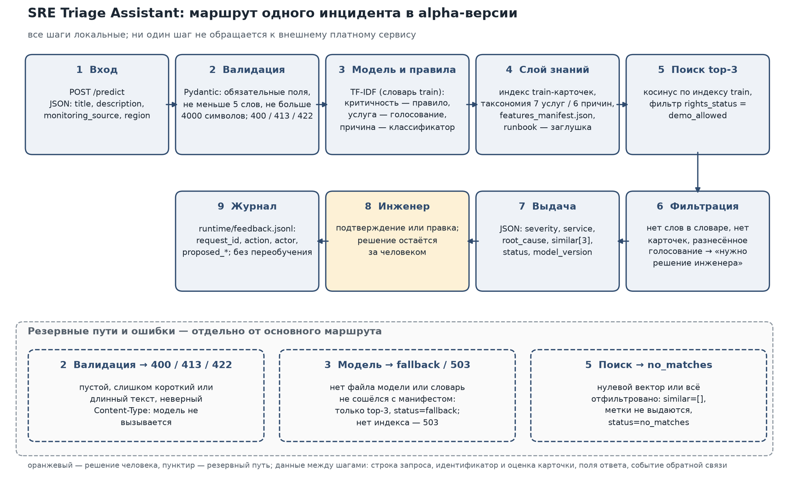

# Архитектура alpha: компоненты, данные, отказы

Схема описывает маршрут одного инцидента: от JSON-запроса до записи в журнал.
Решения о том, чем получена каждая метка, лежат в `architecture_matrix.md`,
инструменты и допущения — в `architecture_decision.md`.

Ни один шаг не обращается к внешнему сервису. Критичность ставит правило по
опубликованной таблице последствий, услугу — голосование по трём ближайшим
карточкам, корневую причину — линейный классификатор. Инженер подтверждает или
правит любую метку, и только его решение попадает в журнал как состоявшееся.

## Компоненты

| № | Компонент | Ответственность |
|---|---|---|
| 1 | Вход `POST /predict` | принимает JSON; тело разбирается как контракт, а не как свободный словарь |
| 2 | Валидация и нормализация | проверяет поля, длину и число слов, приводит текст к нижнему регистру, схлопывает пробелы, ставит `request_id` |
| 3 | Модель и правила | считает TF-IDF по словарю train, ставит критичность правилом, услугу голосованием, причину классификатором |
| 4 | Слой знаний | индекс карточек train с метками и правами, таксономия, отпечаток словаря; runbook — заглушка |
| 5 | Поиск top-3 | косинус по индексу train, фильтр по правам, детерминированная сортировка |
| 6 | Фильтрация | решает, нужен ли метке флаг «решение инженера», и собирает статус отказа |
| 7 | Выдача | собирает JSON-ответ по контракту README и добавляет версии модели |
| 8 | Инженер | принимает, правит или отклоняет подсказку |
| 9 | Журнал | дописывает событие обратной связи; автоматического переобучения нет |

## Что передаётся между компонентами

| Переход | Объект и поля | Инвариант |
|---|---|---|
| 1 → 2 | `PredictRequest{title: str, description: str, monitoring_source: str \| null, region: str \| null}` | лишние поля запрещены, иначе 422; `monitoring_source` соответствует колонке `source_system` в наборе |
| 2 → 3, 5 | `IncidentQuery{request_id: uuid, model_text: str, char_len: int, token_count: int, language: "ru" \| "en" \| "unknown", passthrough: {monitoring_source, region}}` | `token_count ≥ 5`, `char_len ≤ 4000`; в модель идёт только `model_text` |
| 2 → 3 | `SparseVector{1 × 3 799, nnz: int}` | `nnz = 0` не ошибка: это путь `no_matches` |
| 3 → 6 | `Predictions{severity: {label, basis}, service: {label, support}, root_cause: {label, probability}}` | метки только из закрытых списков 4 / 7 / 6 |
| 4 → 5 | `Catalogue{cards: [{incident_id, service, root_cause, severity, created_at, excerpt}], policy: "demo_allowed_only", vocabulary_sha256: str}` | в каталог попадают только `rights_status = demo_allowed` и `synthetic = true` |
| 5 → 6 | `NeighbourList[≤ 3]{incident_id, score, service, root_cause, severity, excerpt ≤ 140}` | сортировка `(-score, incident_id)`; пустой список допустим |
| 6 → 7 | `GateDecision{per_label: {status: "auto" \| "needs_engineer", reasons: [code]}, global: "ok" \| "fallback" \| "no_matches"}` | `label = null` только при `global ∈ {no_matches, fallback}`; флаг `needs_engineer` метку не стирает |
| 7 → 8 | `PredictResponse{request_id, status, severity: {label, basis, requires_review}, service: {label, support, requires_review}, root_cause: {label, confidence, requires_review}, similar_incidents[≤ 3], catalogue_policy, model_versions, degraded[], latency_ms, disclaimer}`, где `basis ∈ {"impact_phrase", "classifier"}` | метка и флаг едут вместе: инженер видит и значение, и пометку, и откуда оно взялось |
| 8 → 9 | `EngineerDecision{request_id, decided_at, actor, action: "accept" \| "override" \| "reject", proposed: {severity, service, root_cause} \| null, note \| null}` | значения проверяются по таксономии |
| 9 | `FeedbackRecord{request_id, received_at, request_hash, prediction, decision, model_versions, latency_ms}` | только дописывание, без текста карточки |

## Слой знаний

Слой знаний — это не модель, а данные, без которых ответ нельзя проверить:

- индекс 3 600 карточек train с метками, датой и коротким фрагментом описания;
- таксономия: 7 услуг, 6 причин, 4 класса критичности (`src/incident_taxonomy.py`);
- таблица последствий `IMPACT_SEVERITY`: 84 фразы на русском и английском с
  критичностью каждой;
- `docs/lab6/features_manifest.json` с отпечатком словаря;
- runbook — заглушка: поля `runbook: {status: "stub", url: null}` в ответе. В
  проекте нет ни одного runbook, и рисовать подсказку как работающий компонент
  нельзя. Обещание «подсказка по runbook» из ЛР 1 остаётся в плане и в v1.

## Где проверяются права

Права проверяются в двух точках, а не в одной:

- на входе — контракт запрещает лишние поля и не принимает файлов, поэтому
  прислать в запросе чужой каталог или изображение нельзя;
- при загрузке индекса — в каталог попадают только карточки с `rights_status =
  demo_allowed` и `synthetic = true`. Это единственное место, где данные
  выбираются по правам, и оно выполняется один раз при старте;
- в ответе — поле `catalogue_policy: "demo_allowed_only"` возвращает политику
  явно, чтобы клиент не додумывал;
- в журнале — сохраняется `request_hash`, а не текст: иначе обещание «нет
  персональных данных» ломается на первой же записи.

Реальные данные оператора в проекте не используются, поэтому проверка прав здесь
проверяет политику набора, а не договор с владельцем данных.

## Отказы и резервные пути

| Случай | Где ловится | Ответ | Поле |
|---|---|---|---|
| Тело не разбирается как JSON | 2 | 400 | `error: invalid_json` |
| Нет `description` или пустая строка | 2 | 422 | `error: description_required` |
| Меньше 5 слов | 2 | 422 | `error: too_short` |
| Больше 4 000 символов | 2 | 413 | `error: too_long`, текст не обрезается: обрезка меняет прогноз |
| Неверный `Content-Type` | 2 | 415 | `error: unsupported_media_type` |
| Лишнее поле в запросе | 2 | 422 | `error: unexpected_field` |
| В тексте нет ни одного слова из словаря | 3, 6 | 200 | `status: no_matches`, `similar_incidents: []`, метки пустые |
| Нет карточек, прошедших фильтр прав | 5, 6 | 200 | `status: no_matches` |
| Нет файла модели | старт | 200 | `status: fallback`, только top-3, метки пустые |
| Нет файла индекса | старт | 503 | `error: artefact_unavailable` |
| Отпечаток словаря не совпал с манифестом | старт | 503 | `error: vocabulary_mismatch` |
| Язык не определён | 2, 6 | 200 | критичность помечается `needs_engineer`, поиск работает |
| Задержка выше 1 000 мс | 7 | 200 | `degraded: ["slow"]`, ответ не блокируется |
| Журнал недоступен для записи | 9 | 200 | `degraded: ["feedback_not_persisted"]`, ответ уже отдан |

Сервис не падает с 500 ни на одном пути: всё, что не является ошибкой контракта,
превращается в статус ответа. Это позволяет интерфейсу ЛР 11 показать инженеру
причину отказа вместо пустого экрана.

## Когда метка помечается «нужно решение инженера»

Флаг ставится по измеренным условиям, а не по общему ощущению:

- критичность — если правило не нашло фразу последствия и сработал классификатор;
- услуга — если победитель голосования собрал меньше половины веса трёх соседей:
  точность в этом случае 0,174 против 0,346 (см. `architecture_matrix.md`);
- корневая причина — всегда. Порог на вероятности проверен и отвергнут: при 0,5
  остаётся 45,7 % ответов с точностью 0,376 против 0,369, а F1-macro падает с
  0,266 до 0,202. Условия, при котором эта метка становится надёжнее, в
  измерении нет, поэтому обещать уверенность нечем.

Флаг не стирает значение: корневая причина приходит вместе с пометкой, инженер
видит и метку, и предупреждение. Пустые метки остаются только в статусах
`no_matches` и `fallback`, где модель или индекс не смогли ответить вообще.

## Чего в схеме намеренно нет

- Векторной базы и эмбеддингов: индекс — 1,57 МБ, полный проход около 2,5 мс. Векторный
  поиск решает задачу от сотен тысяч векторов, а не от 3 600 карточек.
- ONNX: артефакт не сохранён, выигрыша на модели с 3 799 признаками не измерено.
- Очереди и кэша ответов: единственное, что дорого стоит, — сборка индекса и
  обучение моделей при старте (около 0,7 с вместе). Их заменяет сохранённый артефакт,
  а не кэш запросов.
- Авторизации и ролей: один локальный пользователь, журнал пишет `actor` из
  запроса. Проверять подпись события в учебной версии нечем.
- Автоматического переобучения: правки инженера попадают в журнал, решение об
  обновлении данных принимает человек. Иначе одна ошибочная правка меняет модель.

## Соответствие требованиям

Задание ссылается на требования ЛР 3. В нашем проекте ЛР 3 — учебный ноутбук по
Wine Quality, поэтому требования взяты не оттуда, а из проектного плана (ЛР 1) и
из связи с ценностью (ЛР 8): три характеристики, подсказка похожих случаев,
решение за инженером, локальный запуск, бюджет задержки.

| Требование ЛР 1 | Где выполнено |
|---|---|
| Три характеристики на выходе | компоненты 3 и 7: критичность, услуга, причина |
| Подсказка похожих инцидентов | компонент 5, всегда top-3 из истории train |
| Решение остаётся за инженером | компонент 8 и флаг `needs_engineer`; в ответе нет автоматического действия |
| Локальный запуск | ни одного сетевого клиента в маршруте |
| Задержка меньше 1 с | около 2,5 мс p95 на измерении; артефакт вместо обучения при старте |
| Воспроизводимость | словарь только по train, отпечаток сверяется, версии в ответе |
| Проверка преподавателя «хотя бы две характеристики» | все три, причём каждая прослеживается до источника: правило, три карточки, классификатор |
